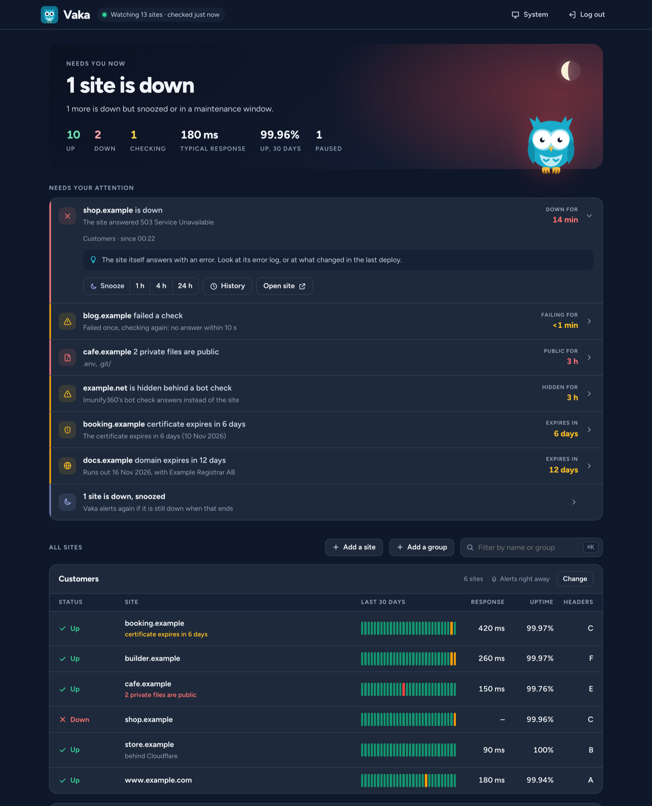
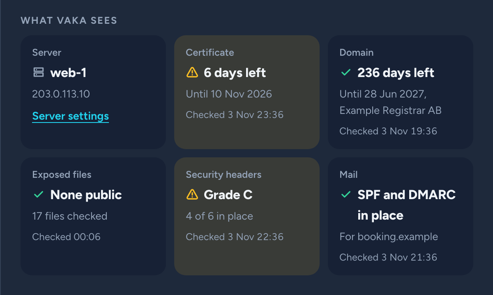
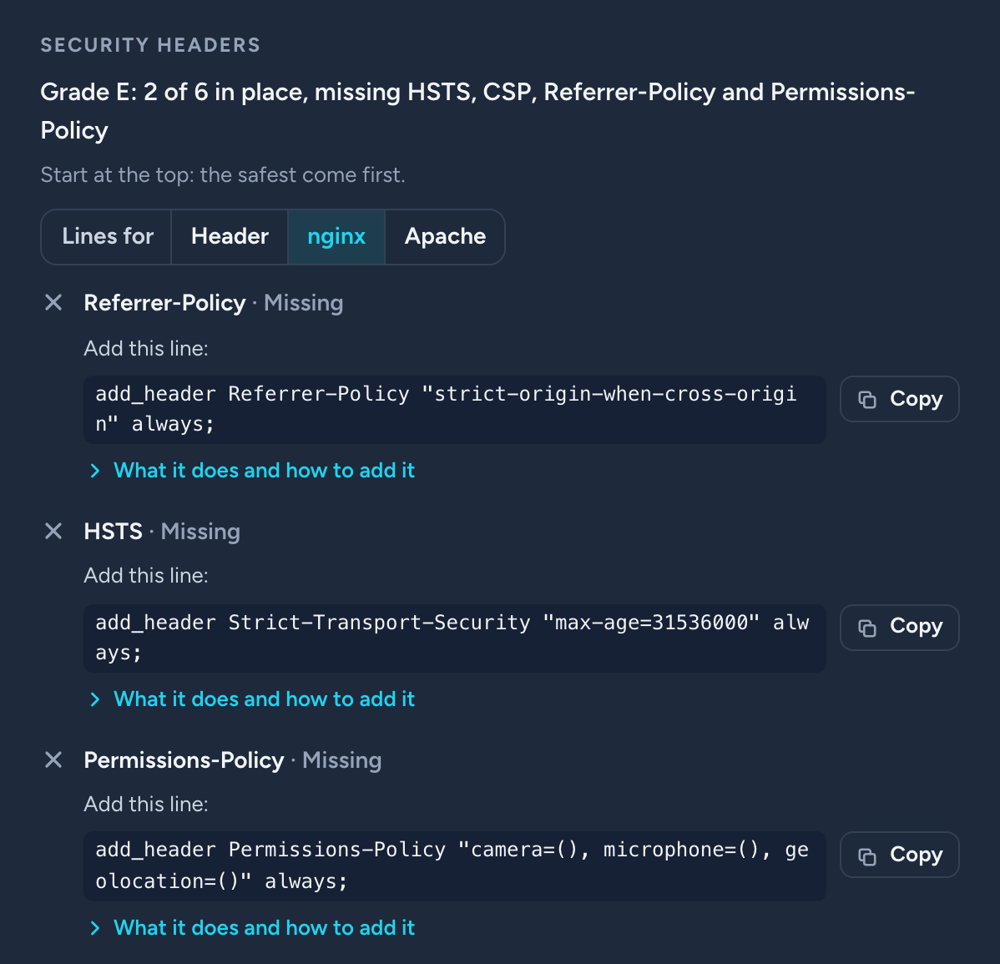

We watch about 50 sites at Webready. Our own, our customers', my side projects.

We had an old Laravel app for that. It hadn't kept up, and since we hadn't built it ourselves we never really knew it inside out. Then came the [PHP2Shell bug](https://github.com/NCSC-NL/php2shell) in October and all our projects and servers had to be gone through. A good time to scrap it.

It also talked too much. When a server with a lot of sites goes down you get one message per site, and then all of them again every hour until someone has fixed it.

Sometimes it just feels easier to start over and do it right when something keeps bugging you. Think new. Build something that complements [Puls](/writing/puls-cookieless-analytics-in-a-single-php-file/). See if it could be good, nice to look at and as maintenance free as possible.

There are plenty of monitors out there already. But most of them send one alert per site too, and I'm still too cheap to pay for something I can run on servers I already have.

So I built [Vaka](https://github.com/webready-se/vaka).

It started as a small MVP. Uptime and certificates, just enough to replace the old one. Then we kept building while it was running, as the reports came in and we saw how it worked. Claude Code wrote most of the code. I made the decisions, tested everything and complained a lot.



## Why the name Vaka?

Vaka is Swedish. It means staying awake to watch over something, like when you sit up at night with a sick kid.

Funny enough, Vigil was one of the names I threw out when I named Puls. Vaka is pretty much the same word in Swedish.

The tagline is "Keeps watch while you sleep", so of course it's an owl. The moon above it is tonight's actual moon, in the right phase, worked out in the browser. Nobody needs that. It's the kind of detail I like.

## One message, not fifty

When Vaka checks a site it remembers which IP address answered. Same IP, same server. And when one site starts failing it checks the others on that server right away, in the same run. So a server going down arrives as one thing:

```
Server web-1 (203.0.113.10) is not answering: all 6 sites are down
shop.example, www.example.com, booking.example, cafe.example, builder.example, deals1.example
No answer within 10 s
```

And one more when it's back:

```
Server web-1 (203.0.113.10) is back: 6 sites up again after 19 min
```

We have servers with a lot of sites on them, and we've seen this work for real. When one of them has a bad moment they all go in the same run, and I get one message instead of one per site.

Down means two failed checks in a row, so one hiccup wakes nobody. Sites behind Cloudflare are alerted on their own, since they share addresses with strangers.

## Snooze and rules per group

Already on it? Snooze it for an hour, four hours or a day. Those are the only choices. There is no "snooze until I say so", because that's how you end up with a site that has been down for a week. If it's still down when the snooze ends you hear about it again.

Each group of sites has its own rules and its own Slack channel. Alerts right away, after a few minutes, as a daily summary or only on the dashboard.

Some of our sites run heavy updates at night and don't always answer while they do. That's expected, and without a way to say so I'd get spammed every night. So they have a maintenance window from midnight to seven. The checks keep running, Vaka just stays quiet. If a site is still down at seven, I hear about it.

## A site can be up and still be in trouble

Then I got curious, like I usually do. If we're looking at the sites anyway, couldn't we get more out of it? Things that make them safer and better.

A `.env` file out in the open. A certificate that runs out on Saturday. A domain nobody remembered to pay for. The site answers 200 and everything looks fine.

So Vaka checks that too. Certificates, domains, exposed files, security headers and mail records, at least once a day, with an alert when something changes.

Exposed files sound easy. But lots of sites answer 200 on every address with a page of their own, so just asking for `/.env` would cry wolf on all of them. Vaka reads the content instead. It also asks for a made-up address every time, and if that gets the same answer it's not a file.



## My own site got an E

I knew the basics of security headers. But CSP I was a bit clueless about. How do you set it up when you can't control every page? What about inline stuff? And what are you supposed to do with it if you run Google Tag Manager? Things also keep happening in that space that I don't keep up with. Best practice is always a good reminder, and it's easy to forget.

Then Vaka looked at jarnesjo.com for the first time. The site you're reading right now got an E. It wasn't the only one, but I'll leave it at that.

I followed what it told me and this site went from E to B on October 29 and from B to A on November 2.

On the way I copied the CSP line from the dashboard into nginx and nginx said no, since the line was written with the colon the way the header looks on the wire. If I trip on that, others will too.

CSP got the most work in the end. Add a script next month and it's blocked in every visitor's browser, and nobody tells you. So Vaka compares the page with its own CSP and says what it blocks. If there's no CSP yet it drafts a first one from the page as Report-Only, so you can see what would break before anything does. And if the page runs Google Tag Manager it says straight out that a strict policy takes more than a line.

## Easy to use, even if you're new to this

We try to keep UX in focus all the time. Everything should be easy to use and easy to understand, and the most important thing should stand out so you see it right away.

So the panel at the top says how things are in one line, and it glows red when a site is down and teal when all is calm. Under it comes what needs you, with what to do about it. A site answering 503 doesn't just say 503. It tells you the site itself answers with an error, and to look at its error log or at what changed in the last deploy.

Remember the colon? Now Vaka tries to read which web server a site runs on, so the lines are already written for nginx or Apache. Click copy and paste it on your server. What each header does and how to add it is one click away. A beginner should be able to use this too.



## The first week taught me the rest

One site on shared hosting got a daily alert saying HSTS had been removed. It hadn't. The host's bot protection had started answering Vaka with a "One moment, please..." page about 18 hours a day, and Vaka graded that page as if it was the site. Most likely Vaka set it off itself. Asking for `/.env` every day is exactly what an attacker does. Now it recognises a bot check, says the site is hidden behind one and stops guessing.

Then the response times looked worse than they should. All of them. Turns out most servers start their scheduled jobs at the top of every minute, which is exactly when cron started Vaka. I measured 2.5 seconds to first byte at second 2 and 0.4 seconds at second 15. So now Vaka waits until second 15.

## Who watches the watcher?

Run it on a different server than your sites, or nothing can tell you when that server dies. Mine doesn't yet. Do as I say, not as I do.

That's why every run also pings a heartbeat URL. For now I use the free tier of [Healthchecks.io](https://healthchecks.io) and get an email if the pings stop.

## Built for AI tools too

This is really the idea behind these tools. We build them so AI tools can use them, so we can work data driven. Make decisions from how things actually look and work instead of guessing. And when you do have a hypothesis it's easy to test it and get an answer. Same thing I wrote about with [Odlingsguiden and Puls](/writing/my-growing-guide-wrote-the-roadmap-for-my-analytics-tool/).

So everything in Vaka is also in a read API, with a read-only token per site. JSON, CSV or a Markdown report written for an AI assistant. In the project for this site I say "kolla sajten" and Claude reads the report and comes back with what to fix in the code right here. Change something, check again, see if it got better.

## Why PHP, again

Same answer as for Puls. PHP is everywhere. SQLite, no framework, no Composer packages at runtime, no build step. Copy the files, add a cron line. It runs on Laravel Forge and on shared hosting.

It needs PHP 8.3 or newer, and the idea is to support PHP versions for as long as they are maintained. I don't want this one to fall behind like the old monitor did.

This is also where "as maintenance free as possible" comes in. Vaka has no packages to keep up to date, only PHP itself. And yes, PHP2Shell showed that you do have to keep that one up to date.

## When to use something else

Vaka checks from the one server it runs on. If you need checks from many places in the world, or phone calls and an on-call rota, use something hosted like [UptimeRobot](https://uptimerobot.com) or [Better Stack](https://betterstack.com/uptime). If you want lots of monitor types and everything in a web interface, look at [Uptime Kuma](https://github.com/louislam/uptime-kuma). Monitoring as code in Git, [Gatus](https://github.com/TwiN/gatus).

Vaka is for people like me. A bunch of sites, some of them your customers', on servers you already pay for.

## It's open source and free

Vaka is [MIT licensed on GitHub](https://github.com/webready-se/vaka). No paid tier. It's still 0.x, so an upgrade may need a step from you and the changelog says which. But it watches all our sites in production.

Download the [latest release](https://github.com/webready-se/vaka/releases/latest) and:

```bash
php vaka user:add admin
php vaka site:add https://shop.example
php vaka run
```

Press Enter at the password prompt and you get a strong one. Then one line in cron:

```
* * * * * php /path/to/vaka/vaka run >> /dev/null 2>&1
```

Try it on your own sites and tell me what you think in the [issues](https://github.com/webready-se/vaka/issues). And when the dashboard just says "All quiet." that's the whole point. Go to bed.
